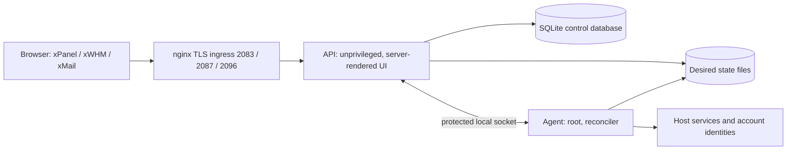

# xPanel

xPanel is an open-source web hosting control panel for Linux servers, in the class of cPanel and WHM, built on a small modern TypeScript core. It ships as three separate products on one server:

| Product | For | Public HTTPS port |
|---|---|---|
| **xPanel** | Account owners and their team members | `2083` |
| **xWHM** | The server administrator (root) and resellers | `2087` |
| **xMail** | Mailbox users: webmail, calendars and contacts | `2096` |

> **Project status: prelaunch.** A tool goes live only after it passes native qualification on all five supported Linux profiles. No tool has passed yet, and the first native qualification run is in progress. See [Project status](#project-status).

## Contents

- [Why xPanel](#why-xpanel)
- [Capabilities by area](#capabilities-by-area)
- [Architecture](#architecture)
- [Security model](#security-model)
- [Requirements](#requirements)
- [Installation](#installation)
- [Upgrade and rollback](#upgrade-and-rollback)
- [Development and testing](#development-and-testing)
- [Project status](#project-status)
- [Contributing, security and license](#contributing-security-and-license)

## Why xPanel

- **Real per-account isolation.** Each account gets its own UID and GID, a private home, an Apache `mpm-itk` identity, its own PHP-FPM pools, a systemd cgroup v2 slice with plan limits, and kernel disk quotas.
- **Configuration files are the source of truth.** Desired hosting state lives in plain entity files, as on cPanel. The SQLite index is derived and can be rebuilt; identity and security records are authoritative and live beside it in the SQLite control database.
- **Privilege separation.** The web API runs unprivileged. One root agent performs host changes through explicit, validated contracts over a protected local socket.
- **Safe changes.** The agent compiles desired state into a configuration generation, validates it with each service's own config test before any reload, and restores the previous generation when verification fails.
- **Signed releases and a native lifecycle.** Releases are authenticated archives with an Ed25519 publisher signature. Upgrades install side by side, snapshot state, migrate, switch atomically and rewind automatically when the health gate fails.
- **Small footprint.** No database server and no JavaScript build step: Node runs the TypeScript sources directly, and SQLite comes from the Node runtime. The control plane targets a 1 vCPU / 1 GB server.
- **Truthful by design.** An unavailable capability refuses with a stable machine code and shows its real state. The catalog opens a tool only on native evidence.
- **English and Arabic.** Full right-to-left support, gettext catalogs, two interface themes and ASCII digits throughout.

## Capabilities by area

The catalog places 536 in-scope tools on 204 pages: 68 in xPanel, 117 in xWHM and 19 in xMail. The source implements the following areas. Each tool still waits for its native qualification before it goes live; see [Project status](#project-status).

| Area | Implemented in source |
|---|---|
| Accounts, plans and resellers | Account creation, suspension and target-bound termination; plans with feature lists and resource limits; reseller ACLs; account team members; bulk account actions; one-time sign-in handoffs from xWHM to xPanel and from xPanel to xMail |
| Web hosting | nginx edge in front of Apache `mpm-itk`; per-account PHP-FPM and PHP version management; redirects, domain forwarding and reverse-proxy rules; `.htaccess` editing; directory privacy and hotlink protection; optional ModSecurity; AWStats, Webalizer and access-log analytics; application catalog and installer |
| Domains, DNS and TLS | PowerDNS with BIND-backend zone files; zone editor with candidate validation; DNSSEC; DNS cluster sync; dynamic DNS; ACME certificates for sites; Let's Encrypt certificates for the three management origins |
| Email | Postfix and Dovecot with maildir, IMAP, POP3, LMTP and Sieve; OpenDKIM; forwarders, autoresponders and filters; mailing lists; BoxTrapper and spam controls; xMail webmail; CalDAV and CardDAV through Radicale |
| Files | File manager confined by a native helper; Web Disk (WebDAV); FTP with Pure-FTPd; Git repositories; file share links; browser terminal through a native PTY helper; jailed login shell |
| Databases | MariaDB and PostgreSQL databases and users; phpMyAdmin and phpPgAdmin single sign-on; remote access rules |
| Security | nftables firewall with ban lists and flood limits; SSH policy that refuses lock-out; optional TOTP two-factor sign-in; scoped API tokens; panel access allowlists and entrance controls; ClamAV account scans; SELinux enforcing on Enterprise Linux |
| Backups and transfers | Scheduled backups with a control-state snapshot per run; gzip or zstd with read-back verification; local disk, S3-compatible and SFTP destinations; granular restore; account transfers between servers; cPanel backup import |
| Operations | Server health and resource observations; service manager; logs; rootless container tools; `xuapi` and `xwhmapi` command-line APIs with the same authorization as the web |

## Architecture



- **API** (`apps/api`): one unprivileged process with three immutable listeners on loopback ports `12083`, `12087` and `12096`, behind an nginx TLS ingress. It renders the HTML, enforces authentication and authorization, and never runs host commands.
- **Agent** (`apps/agent`): the root daemon. It revalidates every request, reconciles desired state into host configuration and runs allowlisted commands as argv arrays.
- **Desired state** (`packages/state`): entity files under `/var/lib/xpanel/state`, written atomically, with generation snapshots for rollback.
- **SQLite** (`packages/db`): principals, password hashes, sessions, MFA, API tokens, jobs, audit and the derived index, in `/var/lib/xpanel/control.db`.
- **Lifecycle** (`packages/lifecycle`, `scripts/`): installer, `xpanel-ctl`, versioned releases under `/opt/xpanel/releases/<version>` with an atomic `current` link, backup, restore, transfer and cPanel import.
- **Pure core** (`packages/core`, `packages/render`, `packages/os`, `packages/catalog`): domain rules, configuration renderers, OS profiles and the capability catalog.

See [docs/ARCHITECTURE.md](docs/ARCHITECTURE.md) for the full design and [docs/STANDARDS.md](docs/STANDARDS.md) for the engineering rules.

## Security model

- **Three separate origins.** Each product has its own HTTPS origin on its own host name. Sessions and CSRF values are bound to their audience, mutations require the exact `Origin`, and the only crossings are single-use, audited handoffs.
- **Content Security Policy on every document:** `script-src 'self'`, `object-src 'none'`, `base-uri 'none'`, `frame-ancestors 'none'`, with no inline scripts.
- **Tenant isolation:** per-account UID, `mpm-itk`, PHP-FPM, cgroup slice and quota; `/home` at `0711`; tenant identities never join the service groups.
- **Credentials:** Argon2id password hashes, optional TOTP with single-use recovery codes, hashed scoped API tokens, and session revocation on credential changes.
- **Privileged boundary:** kernel peer-credential checks on the agent socket, a protected service credential, config tests before every reload, and native file and terminal helpers that the agent runs only while they match their root-owned digests.
- **Signed releases:** the installer and upgrader verify the archive inventory and the Ed25519 publisher signature before any file is extracted.
- **Native lifecycle with rollback:** writers are drained under an admission lock, state is snapshotted, and a failed health gate rewinds the release link, state files, index and units.

Report vulnerabilities privately as described in [SECURITY.md](SECURITY.md).

## Requirements

| Item | Requirement |
|---|---|
| Operating system | Ubuntu 22.04 LTS, Ubuntu 24.04 LTS, AlmaLinux 9, Rocky Linux 9 or CentOS Stream 9 |
| Host | A fresh, dedicated server with root access, systemd and the cgroup v2 `cpu`, `memory`, `io` and `pids` controllers |
| Size | The control plane targets 1 vCPU and 1 GB of memory; hosted services and accounts need more |
| Account storage | `/home` on ext4 (the installer enables journaled quota) or XFS mounted with `uquota` |
| Runtime | Node.js 26.12.1 and a pnpm 12.15.0 executable, installed by the operator before installation |
| DNS | Three names on the management address: `<name>`, `whm.<name>` and `mail.<name>` |
| Ports | `2083`, `2087`, `2096`, `80` and `443` reachable; `80` serves the ACME HTTP-01 challenge |

## Installation

**No public release exists yet.** Installation needs a signed release archive and its trust material from the release publisher, and this repository does not publish a download location. The installer itself is part of each release.

With a release in hand, installation takes these steps:

1. Prepare the host: pinned Node.js and pnpm, DNS records, open ports.
2. Inspect the plan: `bash scripts/install.sh --dry-run --new-install ...`.
3. Install: `bash scripts/install.sh --new-install --artifact=... --artifact-sha256=... --release-trust-file=... --release-keys-file=... --management-hostname=... --management-address=... --acme-email=... --accept-acme-terms`, with optional `--with-mail`, `--with-dns`, `--with-ftp`, `--with-mariadb` and `--with-modsecurity`.
4. Create the root identity, start the services, sign in to xWHM, change the password and complete the first-run setup.
5. Before creating accounts, finalize the installation with `xpanel-ctl install --apply --yes` and register the lifecycle coordinator, which runs native upgrades.

[docs/INSTALL.md](docs/INSTALL.md) is the complete guide, including release verification, DNS, firewall ports and the management TLS step.

## Upgrade and rollback

Upgrades run side by side under the root-owned lifecycle coordinator (`xpanel-lifecycle.service`):

1. **Stage** the signed release: the installed release authenticates the archive and prepares `/opt/xpanel/releases/<version>`.
2. **Rotate** the coordinator to the staged release.
3. **Start** the upgrade from xWHM (preflight, then a typed confirmation) or as root through the release's operator entry.

The upgrade snapshots state, applies expand-only migrations, switches the `current` link and passes a health gate. A failure after the switch rewinds the release link, state files, index and units to the snapshot. An interrupted operation is completed with the operator entry's `recover` kind. After a successful upgrade the lifecycle prunes releases that no record still needs; `xpanel-ctl releases prune --dry-run` shows what it keeps and why. `xpanel-ctl status` and `xpanel-ctl doctor` report the lifecycle state, and `xpanel-ctl update --check` authenticates a release archive without changing anything. Configuration generations roll back separately through the administrative CLI.

See [docs/OPERATIONS.md](docs/OPERATIONS.md) for the exact commands, recovery, backups and TLS.

## Development and testing

Use Node 26.12.1 and pnpm 12.15.0, as pinned in [.node-version](.node-version) and [package.json](package.json):

```sh
node scripts/toolchain.mjs --check
node scripts/toolchain.mjs pnpm install --frozen-lockfile
node scripts/toolchain.mjs pnpm typecheck
node scripts/toolchain.mjs pnpm test:fast
```

- [docs/DEVELOPMENT.md](docs/DEVELOPMENT.md): local runtime, watch mode and development MFA policy.
- [docs/TESTING.md](docs/TESTING.md): test layers, the fast, full and release lanes, browser and native Linux suites.
- [docs/decisions/](docs/decisions/): architecture decision records.

## Project status

xPanel is **prelaunch**. Production readiness is not claimed.

- **Activation gate.** A tool goes live only with native evidence on all five profiles: unit, HTTP, browser, Linux host and external observation. The evidence is published in `packages/catalog/src/data/delivery.ts`; that file is empty at this commit, so the catalog reports **0 verified tools** and gated write controls stay disabled.
- **Qualification.** The reviewed drivers, runner and aggregator exist. The first native qualification run on the five profiles is in progress (2026-11-09).
- **What tests prove.** Portable, HTTP and browser tests use synthetic fixtures and a fake host executor where marked. They do not prove live hosting, mail delivery, recovery or capacity.

See [docs/STATUS.md](docs/STATUS.md), [docs/CAPABILITY-BOUNDARIES.md](docs/CAPABILITY-BOUNDARIES.md) and [docs/decisions/qualification.md](docs/decisions/qualification.md).

## Contributing, security and license

- **Contributing:** see [CONTRIBUTING.md](CONTRIBUTING.md). Contributors sign the [Contributor License Agreement](CLA.md) once, and everyone follows the [Code of Conduct](CODE_OF_CONDUCT.md).
- **Security:** report vulnerabilities privately through [SECURITY.md](SECURITY.md). Do not open public issues for security problems.
- **License:** [GNU Affero General Public License v3.0 only](LICENSE) (AGPL-3.0-only). Commercial licensing is available from the maintainer.

### Trademarks

cPanel® and WHM® are registered trademarks of cPanel, L.L.C. aaPanel, CloudLinux, WHMCS, Cloudflare and other product names are trademarks of their respective owners. xPanel is an independent project and is not affiliated with, endorsed by or sponsored by any of them; these names are used only to describe compatibility and migration paths.
