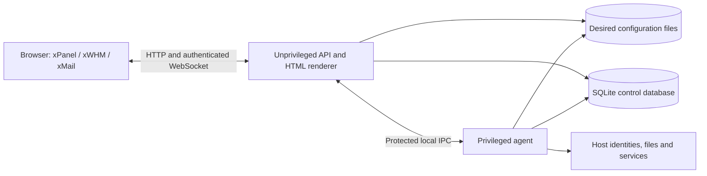

# xPanel architecture

xPanel has three user surfaces: xPanel for account owners, xWHM for root and resellers, and xMail for account users. Mailbox-specific authentication remains a launch requirement. This document distinguishes current structure from the behavior required for launch. See [status](STATUS.md) for qualification limits and [standards](STANDARDS.md) for engineering requirements.

## Workspace and process boundaries

The workspace contains 7 libraries and 3 applications:

| Module | Responsibility |
|---|---|
| `packages/core` | Domain types, validation rules, limits, errors and host-action contracts |
| `packages/catalog` | Tool definitions, feature/ACL metadata, translations and evidence-based delivery assessment |
| `packages/os` | Distribution profiles and installation plans |
| `packages/render` | Pure configuration renderers |
| `packages/state` | Desired-state files, schemas, atomic operations and generation snapshots |
| `packages/db` | SQLite identity, security, operational repositories and derived indexes |
| `packages/lifecycle` | Backup/restore, archive import, transfer and upgrade orchestration through injected ports |
| `apps/api` | HTTP validation, authentication, authorization, orchestration and WebSocket transport |
| `apps/agent` | Privileged daemon, reconciliation, executors, service adapters and confined account-file execution |
| `apps/web` | Server-rendered HTML, styles, translations and browser clients |

Rules and renderers remain pure. The API owns request authority and application orchestration; it must not construct a privileged executor or run host commands. The agent revalidates requests and uses explicit host capabilities. Shared contracts or imports are not permission to bypass that process boundary.

The current web implementation renders HTML in the API process and adds browser clients for login, navigation and live updates. It is not a separate frontend SSR service, and it is not currently an entirely static UI served by Nginx.

The shared UI contract uses IBM Plex Sans for English interface text and brands and IBM Plex Sans Arabic for Arabic interface text, including ordinary navigation. Monospace is confined to technical content. Caption, label, body, card-heading and page-heading roles use a consistent hierarchy with shared spacing and independent 44px interaction targets; see [standards](STANDARDS.md). Rendered layouts still require browser verification at supported widths and directions.

### Immutable application profiles

The executable API entrypoint creates three immutable applications in one unprivileged process, sharing one SQLite handle, state store and privileged-agent client. Each application owns a separate loopback HTTP listener and a fixed server-selected surface:

| Profile | Public HTTPS port | Private HTTP port | Interactive role | Home |
|---|---|---|---|---|
| xPanel | `2083` | `12083` | Account user | `/panel` |
| xWHM | `2087` | `12087` | Root or reseller | `/whm` |
| xMail | `2096` | `12096` | Account user | `/mail` |

These are three profiles/listeners, not three isolated operating-system processes. Explicit loopback binds and all exact HTTPS origins are validated before database opening; production listeners must use their reserved private ports. A partial startup failure closes already opened listeners, upgraded sockets, subscriptions and shared resources. There is no fallback to a shared login listener.

The public TLS boundary is an independently configured ingress. It must preserve the exact public Host including port, overwrite forwarded protocol/client headers, and provide a protected ingress credential before the API trusts HTTPS or client identity. See the [ingress guide](../deploy/nginx/README.md) for required configuration and deployment limitations.

### Page navigation and mail rendering

The page palette is generated from all navigation pages currently available to the authorized surface. Localized text filtering, selected-result announcements, Arrow Up/Down wrapping and Enter use those existing links; Escape restores usable focus. It is page navigation only. It cannot create commands, grant an unavailable capability or replace authorization at the destination. Native input and textarea editing must retain ordinary slash and shortcut text.

The wide mail workspace has three total columns: folders in the shell, then a message list and one reading pane. The composition route uses a bounded editor and optional sender/quota observations. Supplied message data are escaped observations, not evidence of production mailbox authority or delivery. Its Send control is disabled and non-submitting while live delivery is unqualified. A rendering change does not close mail acceptance.

Reduced-motion CSS disables transitions and animations instead of merely shortening them. This prevents a visibility transition from leaving a modal hidden when its focus-entry handler runs. Both motion preferences must satisfy the same dialog, focus trap, Escape and focus-return contract.

## Authority and storage

- **Desired hosting configuration:** entity files under `/var/lib/xpanel/state/`, including accounts, domains, plans, resellers and server settings. `packages/state` supplies schemas, atomic file operations and generation storage.
- **Identity and security authority:** SQLite at `/var/lib/xpanel/control.db` holds principals, password hashes, MFA/enrollment state, sessions, API-token hashes and revocations. These cannot be reconstructed by reindexing desired-state files.
- **Operational records and derived indexes:** jobs, metrics, audit records and searchable views share the control database but have distinct retention and recovery needs.
- **Generated service configuration:** the reconciler derives host configuration from desired state. Live files and service observations can drift independently and must be checked.

Atomic replacement of one file does not make a multi-file change, a database transaction and host effects crash-atomic together. Cross-store journals, compensating actions, stale-resource removal and interrupted recovery require their own failure tests.

For an unqualified workspace, the renderer first reads a bounded account/plan/feature-policy projection and avoids scanning unrelated service state. The projection reads fresh authoritative files under a real cross-process lease, checks fencing before and after, and retains the associated lease metadata writes. It is not an authorization cache or a zero-write read path. Identity-only administration avoids an account projection when no account is selected. Qualified service screens still read and re-authorize their full snapshot.

The existing full-snapshot fallback has separate consistency/recovery acceptance outstanding; this scoped optimization does not close R01. Verify bounded paths and their lock costs against representative data and concurrency on each supported Linux profile. Preserve account visibility, deletion/revocation, freshness and state-consistency semantics; local fixture measurements or Windows RSS cannot establish Linux memory budgets, production INP or capacity.

The API and agent share protected control-database access. The API identity is `xpanel`; the privileged agent uses the IPC group `xpanel-agent` and supplementary data group `xpanel`. Private directory and SQLite WAL/SHM permissions must remain correct across restart. Tenant identities must never join either service group.

Customer databases are separate from the panel's SQLite database. The PowerDNS configuration model uses rendered zone files through its BIND backend. An adapter or renderer alone does not establish service availability.

## Authentication and authorization

Authentication uses Argon2id password verification, persistent sessions, MFA state, recovery controls and hashed scoped API tokens. The policy layer checks principal kind, explicit scope, reseller ACL, account ownership and feature availability. HTML must enforce authority before hydrating hosting state.

For explicit interactive profiles, the listener selects the audience; URL parameters, request headers and requested landing pages cannot select it. Secure session cookie names are distinct, but cookie names/paths alone cannot isolate browser ports. Stored session credential hashes and derived CSRF values also bind the audience. Exact HTTPS origins, required mutation Origin checks, role admission and per-profile HTTP/WebSocket route confinement supplement ordinary ownership/ACL checks. Bearer API tokens do not authenticate these interactive profiles or HTML documents. xMail currently accepts an account control-plane user; it does not supply mailbox principal authentication, a live inbox, or qualified SMTP/IMAP delivery.

WebSocket connections require authenticated, scoped authority, origin/IP policy and continued validity. Session revocation or account changes must affect existing connections as well as future HTTP requests. A trusted socket connection does not itself authorize an arbitrary account operation.

The agent combines protected service credentials, persisted principal authority and native peer identity. Native account-file execution uses a separate confined helper; missing execution prerequisites fail explicitly rather than falling back to unrestricted root I/O.

### Account mutation contracts

The HTTP boundary re-reads the persisted account and current authority before account mutations. State changes use a writer lease and expected-revision checks; bounded host replies are validated before acknowledging global configuration. Credential and file-state updates are not claimed to be one crash-atomic transaction.

Creation requires a password and an explicit usable IPv4 or an actually configured primary address; no address is invented. Suspension revokes sessions/tokens for all linked account principals through a database transaction. Unsuspension completes access cleanup before making the account active, preserving independent manual disables. Failure or uncertainty requires verification rather than a hosting-success event.

A validated agent response can acknowledge `configuration_applied` with `scope: global_configuration`, `targetVerified: false` and `verificationRequired: true`. It is not a target-bound completion receipt. The client keeps the result pending and prevents duplicate submission when state or host outcome is uncertain.

DELETE authorizes the current target, checks exact username confirmation, re-reads the target and returns HTTP 412 with `target_bound_purge_unavailable`. It does not delete account state, principal identity or host resources. A PATCH containing only contactEmail returns 412 with `metadata_index_update_unqualified` before effects; it does not fall back to a global snapshot/reindex write. A durable account lifecycle/purge executor, operation-specific receipts and recovery remain open requirements.

## Reconciliation and workload isolation

The required reconciliation sequence is to capture desired state, compile a candidate generation, validate it, apply authorized effects, reload only valid configuration, verify actual services and record the outcome. Failed verification must preserve or restore a known working configuration. Durable intent/result and recovery semantics remain acceptance requirements wherever they are not demonstrated end to end.

The workload model uses per-account UID/GID, private home and temporary directories, systemd cgroup v2 slices, kernel disk quotas and per-account PHP execution. Apache `mpm-itk` and PHP-FPM configuration must be qualified with actual HTTP workloads. Text containing `AssignUserId`, `setpriv` or a slice name is not proof of effective identity or resource enforcement.

Nginx is intended to terminate public HTTP/TLS and proxy to backend services without reading tenant homes. Backend exposure and cross-tenant access must be measured from an external observer as well as from inside the host. Missing controllers, quota support or an unavailable web engine must be reported explicitly.

## Lifecycle and recovery

Lifecycle libraries use injected filesystem, host, clock, audit and operation-specific ports. Production callers must supply real implementations; successful state-machine fixtures are not proof of production wiring.

Backups must consistently bind desired state, control-database identity/security records, sealing keys and the intended customer data. Restore acceptance checks files, ownership, database contents, service behavior and retained authority, not only a reconstructed state object. Untrusted archives require path/link validation, bounded streaming and safe extraction under the correct identity.

Transfers require durable leases, checkpoints, idempotent retries and a recoverable cutover. Upgrades require authenticated artifacts, versioned provenance, consistent snapshots, migration policy, actual health probes and a tested rollback or explicit recovery path. Startup recovery can alter state; replacing application files is not a complete rollback procedure.

## Delivery and release boundaries

The catalog assessor uses `researched`, `implemented`, `integrated`, `verified` and `out-of-scope` states. Production tool navigation admits only qualifying verified capabilities. Source/artifact identity, environment, acceptance criteria and outcomes must match; a test name or fixture page cannot promote delivery.

The read-only workspace fallback can display the signed-in identity and a bounded whitelist of authorized account/plan fields without qualifying hosting tools. It does not render unfiltered provider payloads or imply service health. Seven administrative destinations have separate root-only navigation metadata; their screens and actions remain unimplemented. Navigation definitions and synthetic fixture pages are not production feature delivery.

Release packaging selects runtime inputs explicitly, rejects credentials and unsafe archive entries, checks runtime module closure, and records manifests and dependency provenance. Reference material and development dependencies do not belong in the production artifact. Archive verification, native build provenance, installation and live service acceptance are separate steps.

See [testing](TESTING.md) and the [acceptance matrix](planning/ACCEPTANCE-MATRIX.md) for the evidence required before these architectural contracts become production claims.
