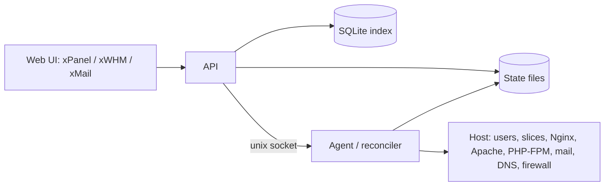

# xPanel architecture

xPanel is a web hosting control panel with three surfaces:

- **xPanel** for account owners (sites, domains, mail, databases, files, security),
- **xWHM** for root and resellers (accounts, plans, resellers, server, services, security),
- **xMail** for mailbox users (webmail, filters, calendars and contacts).

Behavior is taken from public documentation of established panels, rebuilt from scratch and proven by tests. No proprietary code, layouts or assets are reused. How the code is written is defined in [STANDARDS.md](STANDARDS.md).

## Principles

1. **Configuration files are the source of truth.** The desired state of every account, domain, plan, reseller and server setting is a file. A broken database never loses a customer's setup.
2. **The interface never touches the host.** The API validates and writes desired state; a privileged agent reconciles the host to it.
3. **Every change is tested before it is live.** The agent renders a complete configuration generation, runs each service's own config test, switches atomically, and keeps the previous generation for rollback.
4. **Each account is isolated.** Its own UID, home, PHP pools, processes and limits, enforced by the kernel.
5. **Light on resources.** It must run on a 1 vCPU / 1 GB server and reserve as little as possible.

## State storage

- **Desired state:** one JSON file per entity under `/var/lib/xpanel/state/`, written atomically (temp file, fsync, rename, fsync directory) and validated by the same schemas the API uses. The agent re-validates everything it reads.
- **Config generations:** each applied change produces a numbered generation of rendered host configuration. A failed config test leaves the previous generation live.
- **Index database:** SQLite (`node:sqlite`) holding the search index, sessions, jobs, metrics history and the audit index. It is rebuildable from the state files at any time (`xpanel reindex`); on mismatch the file wins.
- **Audit log:** an append-only JSON-lines file first, indexed second.
- **Isolation from service databases:** the panel runs no database server. Customer databases live in MariaDB (PostgreSQL when enabled). PowerDNS reads zone files rendered by the agent.

## Runtime isolation

Each account has its own UID and GID, a `0750` home, `0640` files and a private temporary directory.

- **Apache** runs one server with `mpm-itk`; the child serving a host drops to the account UID (`AssignUserId`). If the distribution has no itk package, that engine is reported unavailable — there is no silent fallback to a shared web user.
- **Nginx** listens on 80/443, terminates TLS and proxies to Apache on a loopback port that the firewall closes. Nginx never opens files inside account homes; it caches responses, not files.
- **`xpanel-<uid>.slice`** (systemd, cgroup v2) contains the account's PHP-FPM masters, CGI, Node/Python/Ruby apps, cron timers and shells. Plan limits apply to the slice: disk quota, IO bandwidth and IOPS (`IOReadBandwidthMax`, `IOWriteBandwidthMax`, `IOReadIOPSMax`, `IOWriteIOPSMax`), memory, process count and CPU. Unlimited is always explicit. Limits the host cannot enforce (for example a missing IO controller) are shown as not enforced.
- **PHP** gets `open_basedir` on the home and its temporary directory, dangerous functions disabled by default, and private `/tmp` for account units. MariaDB users only see the account's own databases. FTP sessions run as the account and are chrooted to the home.

## Edge and PHP handlers

- Nginx workers and Apache MPM settings are sized from cores and memory by the setup wizard and saved as editable values.
- **PHP-FPM** is the default: one pool per account and PHP version, running as the account inside its slice (`ondemand`, `dynamic` or `static`, with all worker fields). **CGI** runs through `suexec`. **suPHP-style** execution is available only when itk is off and is labelled as sharing Apache children. **lsphp** is available with the OpenLiteSpeed engine, which replaces Apache server-wide.
- Several PHP versions run side by side, each with its own extensions and `php.ini`. Per-site PHP settings go to `.user.ini` or the pool, because `php_value` lines in `.htaccess` are not honoured by these handlers; `.htaccess` itself works because requests pass through Apache with `AllowOverride All`.
- Site types: PHP, static, reverse proxy, Node.js, Python. Site settings cover domains, run directory, rewrites, redirects, logs, stop/start, expiry, a path quota inside the account quota and a default site for unbound names. Deletes go to a trash first.

## Management model

Every entity supports list, create, view, edit, suspend, unsuspend, delete, change owner, change plan and limit edits. Resellers see only what they own; root sees everything.

- **Plans:** feature list, disk, monthly bandwidth, IO, memory, processes, caps on addon/alias/sub-domains, mailboxes, FTP accounts, databases and lists, dedicated or shared IP, shell access.
- **Accounts:** UID, primary domain, plan. Termination after confirmation removes home, slice, vhosts, mailboxes and databases.
- **Resellers:** privileges, caps on account count and total disk and bandwidth, optional overselling, delegated nameservers and IPs. Creation is refused when a cap would break and overselling is off.
- **Domains:** primary, addon, alias and subdomains with primary rename; wildcard via a `*` DNS record and `ServerAlias`, where an explicit subdomain wins.
- **Service users:** mail, FTP and Web Disk logins on the account's UID; they cannot sign in to the panel.
- Feature lists hide xPanel tools; reseller privileges hide xWHM tools. Screens are generated from one tool catalog, and a tool is shown only when its acceptance test exists and passes.

## Certificates, backups and wizards

- **First-run wizard:** hostname, nameservers, admin email, web engine and suggested workers.
- **SSL wizard:** existing certificate, ACME issuance or upload; single name or wildcard; HTTP-01 or DNS-01 (temporary TXT records written to the zone and removed). AutoSSL renews before expiry.
- **Backup wizard:** full or partial (home, databases, mail forwarders and filters) to download, the account folder or remote storage. Restores show a diff and never delete files that are missing from the archive.

## Protection

- nftables firewall that drops inbound traffic except the panel, HTTP/HTTPS and SSH ports; port, address, forwarding, ICMP and prefix-list rules with JSON import/export. A change that would lock out the current session is refused.
- Panel sign-in lockout by username and address, configurable port, allow list, two-factor authentication and scoped API tokens.
- An Nginx WAF (rate limits, address/path/user-agent rules, body size) plus OWASP CRS when ModSecurity is installed. Intrusion detection bans addresses after repeated failed logins across services.
- SSH settings for port, key or password authentication and root login policy; compilers restricted to root and an approved group.

## Operating systems and transfers

- Ubuntu 22.04 and 24.04 through `apt`; CentOS Stream 9 and 10, AlmaLinux and Rocky Linux through `dnf`. Unknown systems stop the installer; CentOS Linux 7 is not supported.
- Transfers between xPanel servers authenticate with an SSH key or API token, let the operator pick accounts and plans, show progress and a review before applying, and never restart shared services mid-transfer.
- A cPanel full backup can be imported from its documented layout (home directory, SQL dumps, DNS zones, mail). Each imported account gets a new UID, slice and vhost; source passwords are never kept.

## Upgrades without harm

- Product versions follow SemVer; the index schema has its own number. Root sees the current and available versions, the preflight report and the upgrade history.
- **Preflight:** free space for two releases, supported OS, no transfer running.
- **Snapshot:** the state tree and the current generation. Homes, mail and customer databases are never touched by an upgrade.
- **Side by side:** the new release unpacks into its own directory; migrations are numbered, idempotent and expand-only.
- **Switch, then health check:** reconciled state equals desired state, a canary account is still served under its own UID, and panel sign-in works. A failing check restores the previous release, snapshot and generation automatically and writes the outcome to the audit log.

## Proofs

The system counts as working only when these are demonstrated on Linux:

- Account A cannot read account B's files or databases; files created by a site belong to the account UID; Nginx cannot read homes.
- The Apache child serving a host runs as that account's UID; its PHP-FPM pool runs inside the account slice; `io.max` and the memory limit match the plan, and a write loop inside the slice stays under its cap.
- A plan cap refuses one addon domain too many; the disk quota refuses an upload; a reseller cannot see another reseller's accounts or exceed its totals when overselling is off.
- `.htaccess` rewrites work; a wildcard certificate serves a subdomain that was never created on its own; restoring a database leaves the home untouched.
- A bad configuration is never reloaded; a transfer archive restores files, tables and mailboxes on a new slice.
- A trial upgrade that fails its health check returns to the previous release with account files unchanged; a successful upgrade keeps UIDs and limits.
- The CentOS adapter returns `httpd` and PHP package names in a dry run.
